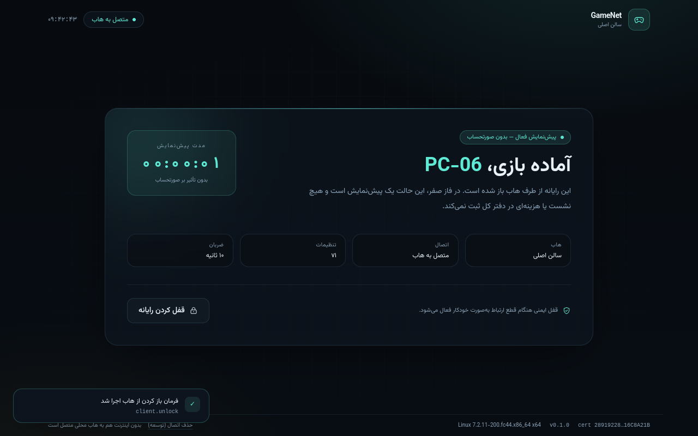
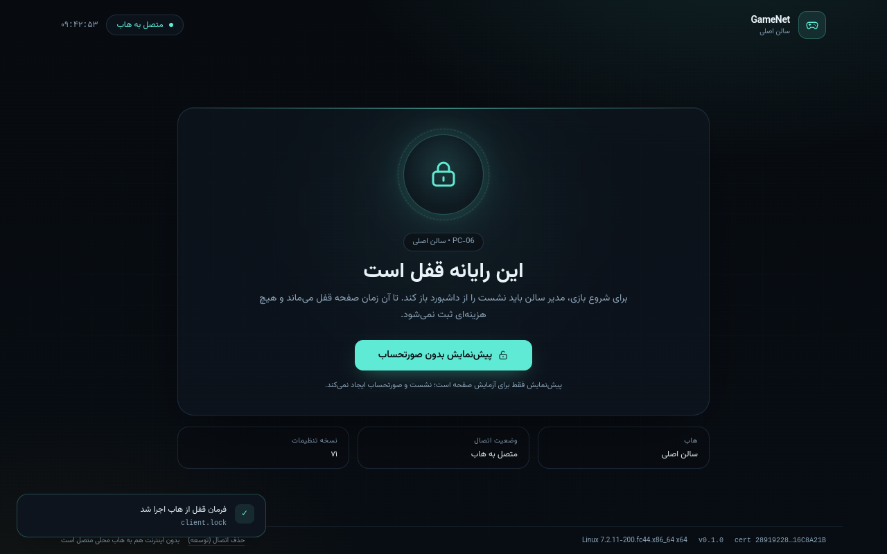

# Phase 0 acceptance proof

- Result: **PASS — 10/10**
- Started: `2026-10-31T06:12:20.117685+00:00`
- Finished: `2026-10-31T06:13:10.449800+00:00`
- Duration: 50.33s

## Environment

```json
{
  "cloud": {
    "base": "https://127.0.0.1:18443",
    "status": "ok",
    "role": "cloud",
    "version": "0.1.0-phase0"
  },
  "edge": {
    "base": "https://127.0.0.1:19443",
    "status": "ok",
    "role": "edge",
    "version": "0.1.0-phase0"
  },
  "edge_id": "01a18e45-00ea-7f5b-8631-0d6406670e55",
  "admins": {
    "cloud": {
      "created": false,
      "promoted": false,
      "username": "admin",
      "is_staff": true,
      "is_superuser": true
    },
    "edge": {
      "created": false,
      "promoted": false,
      "username": "admin",
      "is_staff": true,
      "is_superuser": true
    }
  },
  "tls": "CA-verified HTTPS/WSS (the Electron client additionally pins the edge certificate)"
}
```

## Checks

| # | Check | Result | Seconds |
|---|-------|--------|---------|
| 1 | Edge registration and credential authentication | ✅ | 1.06 |
| 2 | Device registration over edge HTTPS | ✅ | 2.86 |
| 3 | Device heartbeat over WSS and HTTPS | ✅ | 1.17 |
| 4 | Local edge dashboard shows the live device | ✅ | 0.02 |
| 5 | Cloud dashboard shows the replicated device | ✅ | 0.58 |
| 6 | Cloud dashboard command reaches and executes on the edge | ✅ | 2.29 |
| 7 | Cloud command is forwarded to the real Electron client | ✅ | 32.9 |
| 8 | Edge event replicates to the cloud through the outbox | ✅ | 1.87 |
| 9 | Duplicate and sequence-reused events are rejected | ✅ | 1.04 |
| 10 | Offline events stay queued and sync after the cloud returns | ✅ | 3.7 |

### 1. Edge registration and credential authentication

**PASS** in 1.06s

```json
{
  "cloud_record": {
    "id": "01a18e45-00ea-7f5b-8631-0d6406670e55",
    "name": "سالن اصلی",
    "status": "ONLINE",
    "credential_hash_length": 64,
    "command_public_key_length": 44,
    "last_acked_sequence": 50,
    "last_sync_at": "2026-10-31T06:11:52.830492+00:00"
  },
  "local_identity": {
    "edge_id": "01a18e45-00ea-7f5b-8631-0d6406670e55",
    "name": "سالن اصلی",
    "command_public_key_length": 44
  },
  "authenticated_config_http": 200,
  "config_up_to_date": false
}
```

### 2. Device registration over edge HTTPS

**PASS** in 2.86s

```json
{
  "deactivated_previous_proof_devices": [
    "PROOF-PC-061057-42bc"
  ],
  "device": {
    "id": "01a19096-80fb-7a6e-8c6f-bee02f43ba32",
    "name": "PROOF-PC-061224-37f0",
    "hostname": "PROOF-WIN7"
  },
  "credential_issued": true,
  "credential_length": 43,
  "cloud_replica": {
    "exists": true,
    "name": "PROOF-PC-061224-37f0",
    "is_replica": true,
    "status": "OFFLINE"
  },
  "ws_path": "/ws/device/",
  "hub_name": "سالن اصلی",
  "heartbeat_seconds": 10
}
```

### 3. Device heartbeat over WSS and HTTPS

**PASS** in 1.17s

```json
{
  "websocket": {
    "welcome_type": "welcome",
    "hub_name": "سالن اصلی",
    "desired_state": "LOCKED",
    "heartbeat_seconds": 10,
    "heartbeat_ack": "heartbeat_ack",
    "server_time_present": true
  },
  "rest": {
    "http": 200,
    "desired_state": "ONLINE",
    "config_version": 1
  },
  "persisted": {
    "status": "ONLINE",
    "last_heartbeat_at": "2026-10-31T06:12:27.352367+00:00",
    "application_version": "0.1.0-proof"
  }
}
```

### 4. Local edge dashboard shows the live device

**PASS** in 0.02s

```json
{
  "http": 200,
  "url": "https://127.0.0.1:19443/devices/?q=PROOF-PC-061224-37f0",
  "device_visible": true,
  "status_online_visible": true,
  "snippet": "en align-items-center mb-2\"> همه دستگاه‌ها </form"
}
```

### 5. Cloud dashboard shows the replicated device

**PASS** in 0.58s

```json
{
  "cloud_replica": {
    "exists": true,
    "status": "ONLINE",
    "last_heartbeat_at": "2026-10-31T06:12:27.352367+00:00"
  },
  "edge_dashboard_http": 200,
  "device_visible": true,
  "edge_name_visible": true,
  "overview_http": 200,
  "snippet": "name=\"action\" value=\"ping\"> PROOF-PC-061224-37f0 01a19096 <span clas"
}
```

### 6. Cloud dashboard command reaches and executes on the edge

**PASS** in 2.29s

```json
{
  "cloud_command": {
    "id": "01a19096-8eeb-7eda-b1ca-2ad29730d2d6",
    "status": "ACKNOWLEDGED",
    "result": {
      "pong": true,
      "edge_id": "01a18e45-00ea-7f5b-8631-0d6406670e55",
      "server_time": "2026-10-31T06:12:29.922288+00:00"
    },
    "error": "",
    "issued_at": "2026-10-31T06:12:28.523357+00:00"
  },
  "edge_inbound": {
    "command_id": "01a19096-8eeb-7eda-b1ca-2ad29730d2d6",
    "status": "SUCCEEDED",
    "executed_at": "2026-10-31T06:12:29.923393+00:00"
  }
}
```

### 7. Cloud command is forwarded to the real Electron client

**PASS** in 32.9s

```json
{
  "client": {
    "id": "01a18e61-baad-77c3-9a25-fd94ab87caf8",
    "name": "PC-06",
    "status": "LOCKED",
    "last_heartbeat_at": "2026-10-31T06:12:21.583299+00:00",
    "application_version": "0.1.0"
  },
  "unlock": {
    "status": "ACKNOWLEDGED",
    "result": {
      "locked": false,
      "source": "hub"
    }
  },
  "lock": {
    "status": "ACKNOWLEDGED",
    "result": {
      "locked": true,
      "source": "hub"
    }
  },
  "ping": {
    "status": "ACKNOWLEDGED",
    "result": {
      "pong": true,
      "app_version": "0.1.0",
      "client_time": "2026-10-31T06:13:01.703Z"
    }
  },
  "edge_device_command": {
    "id": "01a19096-f56a-78ef-82c1-fd4a3097f343",
    "type": "client.ping",
    "status": "ACKNOWLEDGED",
    "result": {
      "pong": true,
      "app_version": "0.1.0",
      "client_time": "2026-10-31T06:13:01.703Z"
    }
  },
  "ui_assertions": [
    "unlocked screen",
    "locked screen"
  ]
}
```

### 8. Edge event replicates to the cloud through the outbox

**PASS** in 1.87s

```json
{
  "event_id": "01a19097-1dda-76a6-85c3-81deaf54c142",
  "local_sequence": 66,
  "event_type": "edge.test",
  "aggregate_type": "edge",
  "aggregate_id": "01a18e45-00ea-7f5b-8631-0d6406670e55",
  "schema_version": 1,
  "occurred_at": "2026-10-31T06:13:05.114499+00:00",
  "payload": {
    "note": "issued from cloud dashboard",
    "origin": "cloud_command"
  },
  "status": "APPLIED",
  "received_at": "2026-10-31T06:13:05.147391+00:00"
}
```

### 9. Duplicate and sequence-reused events are rejected

**PASS** in 1.04s

```json
{
  "duplicate_response": {
    "accepted": [],
    "duplicates": [
      "01a19097-1dda-76a6-85c3-81deaf54c142"
    ],
    "rejected": [],
    "watermark": 67
  },
  "sequence_reuse_response": {
    "accepted": [],
    "duplicates": [],
    "rejected": [
      {
        "event_id": "7a980072-344e-4f67-9565-8479ec1c30c0",
        "reason": "sequence already used"
      }
    ],
    "watermark": 67
  },
  "sync_event_count_before": 67,
  "sync_event_count_after": 67
}
```

### 10. Offline events stay queued and sync after the cloud returns

**PASS** in 3.7s

```json
{
  "cloud_stopped_pid": 1931553,
  "cloud_down_seconds": 1.99,
  "event": {
    "event_id": "01a19097-2787-72d3-aaf1-a7be835e4670",
    "local_sequence": 68
  },
  "while_offline": {
    "status": "PENDING",
    "attempts": 0,
    "cloud_acknowledged_at": null
  },
  "after_restart": {
    "status": "SYNCED",
    "attempts": 1,
    "cloud_acknowledged_at": "2026-10-31T06:13:09.248941+00:00"
  },
  "cloud_replica": {
    "exists": true,
    "event_id": "01a19097-2787-72d3-aaf1-a7be835e4670",
    "payload": {
      "note": "offline-e26139c21b",
      "origin": "offline_proof"
    }
  }
}
```

## Screenshots





## Not covered by this run

- Windows 7 SP1 / Windows 10 hardware behaviour (Electron launch, DPAPI, service restart, x86 installer).
- A real network outage between edge and cloud is simulated by stopping the cloud process; it is not a cable pull on Windows.

See `docs/PHASE0.md` for the hardware checklist that still needs to be executed on site.
